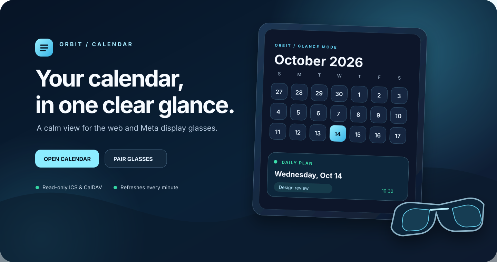
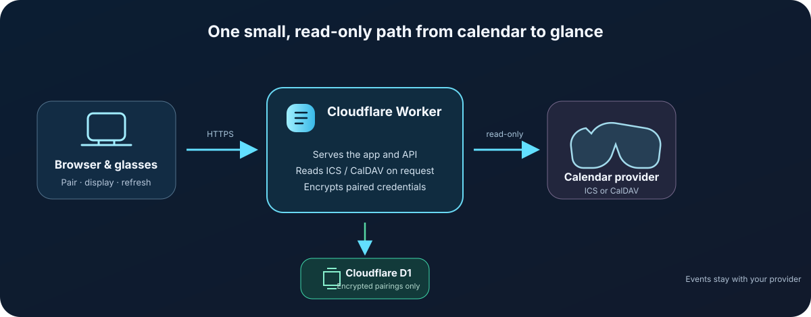

<div align="center">



# Orbit Calendar

### Your calendar, in one clear glance.

A calm, glance-first calendar for the web and Meta display glasses. Connect a read-only ICS feed or a private CalDAV calendar, pair the glasses with a short code, and keep upcoming plans close.

[Open Orbit Calendar](https://orbit-calendar.henning-orbit-calendar.workers.dev/) · [Set up the glasses](https://orbit-calendar.henning-orbit-calendar.workers.dev/glasses.html) · [Read the guide](https://orbit-calendar.henning-orbit-calendar.workers.dev/guide.html)

Part of **Meta Display Apps** — explore [WebUntis Glasses]([https://webuntis-glasses.henning-orbit-calendar.workers.dev/](https://github.com/Henning1908/WebUntis-Glasses)) for your school timetable.

[English guide](docs/USER_GUIDE.md) · [Anleitung auf Deutsch](docs/USER_GUIDE.de.md) · [Deployment](docs/DEPLOYMENT.md) · [Veröffentlichungs-Checkliste](docs/PUBLIC_RELEASE_CHECKLIST.de.md) · [Buy me a coffee](https://gofund.me/89190630b)

</div>

---

## Start in a minute

1. Open the [glasses page](https://orbit-calendar.henning-orbit-calendar.workers.dev/glasses.html) on a supported display browser. Leave it open; a six-digit pairing code appears.
2. On your phone or computer, open [Orbit Calendar](https://orbit-calendar.henning-orbit-calendar.workers.dev/) and choose the settings button.
3. Enter the CalDAV server address, username, and an app password. Enter the code from the glasses and choose **Send calendar to glasses**.

The glasses check for calendar changes every 60 seconds. The code expires after 10 minutes. No account, app install, or payment is required to try the hosted app.

> Need help finding your provider's CalDAV address? See the [step-by-step guide](docs/USER_GUIDE.md) or the [German version](docs/USER_GUIDE.de.md).

## What Orbit does

| Feature | How it works |
| --- | --- |
| Calendar at a glance | Navigate by month, select a day, add local plans, and export an `.ics` file. |
| Read-only calendar sync | Load a public ICS feed, or use a CalDAV URL and credentials. Orbit reads events; it does not write changes back to your provider. |
| Meta display glasses | Pair with a six-digit code and show upcoming events in a compact display view. |
| Automatic refresh | The glasses page fetches current events every 60 seconds and when reopened. |
| Privacy-aware storage | CalDAV credentials for a paired device are encrypted before storage. The glasses keep a device token, not your calendar password. |



## Privacy and data

- Calendar reads are **read-only**. Local plans stay in the browser and are not uploaded to CalDAV.
- A browser-only CalDAV password stays in the open page's memory and is not saved in browser storage.
- When you pair the glasses, Orbit stores the CalDAV connection encrypted in Cloudflare D1 using a Worker secret. The secret is not in this repository.
- Calendar events are fetched from your provider when requested; Orbit does not keep a copy of the event list in D1.
- Disconnect the glasses from the glasses page to remove their saved server connection.

## Cost and availability

The hosted app uses Cloudflare Workers Free and D1 Free. Free plans have usage limits, so this is suitable for personal and low-volume use, not unlimited traffic. If an account reaches a free quota, requests can fail until the quota resets; the app does not upgrade itself to a paid plan. Limits can change—check Cloudflare's current [Workers limits](https://developers.cloudflare.com/workers/platform/limits/) and [D1 pricing and quotas](https://developers.cloudflare.com/d1/platform/pricing/).

## Documentation

- [User guide — English](docs/USER_GUIDE.md)
- [Benutzeranleitung — Deutsch](docs/USER_GUIDE.de.md)
- [Architecture and data flow](docs/ARCHITECTURE.md)
- [Cloudflare deployment and maintenance](docs/DEPLOYMENT.md)

## Develop locally

```sh
npm install
npm run dev
```

Vite serves the interface locally. The production API runs in the Cloudflare Worker; the glasses pairing and sync flow therefore needs the deployed app or a local Worker environment.

For a production build and Cloudflare deployment, follow [docs/DEPLOYMENT.md](docs/DEPLOYMENT.md). Do not commit `.env.cloudflare-secret` or any calendar credentials.

## License

Orbit Calendar is licensed under the [MIT License](LICENSE). You may use, modify, and redistribute the project, including commercially, provided you keep the copyright and license notice in copies or substantial portions. Credit: **Henning1908**. The license does not grant rights to third-party trademarks.

