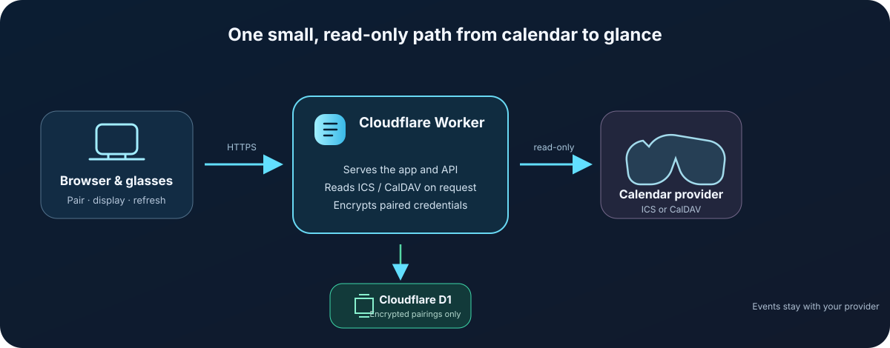

# Architecture

Orbit uses one Cloudflare Worker for the web interface and the JSON API. Cloudflare D1 stores pairing records and encrypted calendar connection settings. ICS and CalDAV servers remain the source of event data.

## Request flow

1. The browser or glasses page sends requests to the same HTTPS Worker origin that serves the interface.
2. The glasses page requests a short-lived pairing code. The phone or computer sends the chosen calendar connection and that code to the Worker.
3. The Worker validates the calendar connection, reads events, encrypts the saved CalDAV settings with AES-GCM, and stores the encrypted payload in D1.
4. When the glasses refresh, the Worker decrypts the connection, fetches current events from the provider, and returns only the event data.

Event lists are fetched on demand and are not stored in D1. The Worker secret `ORBIT_STORAGE_KEY` must remain stable while encrypted connections exist. Changing or losing it prevents the Worker from decrypting those saved connections.

## Components

| Component | Responsibility |
| --- | --- |
| Cloudflare Worker | Serves the app, handles pairing, reads ICS/CalDAV events, and encrypts connection settings. |
| Cloudflare D1 | Stores temporary pairing codes and encrypted device connection records. |
| Calendar provider | Remains the source of truth for events. Orbit uses read-only ICS or CalDAV requests. |
| Browser / glasses view | Displays the month calendar or upcoming events and asks the Worker for refreshes. |

See [deployment and operations](DEPLOYMENT.md) for the resource bindings, secret, and migration commands.
